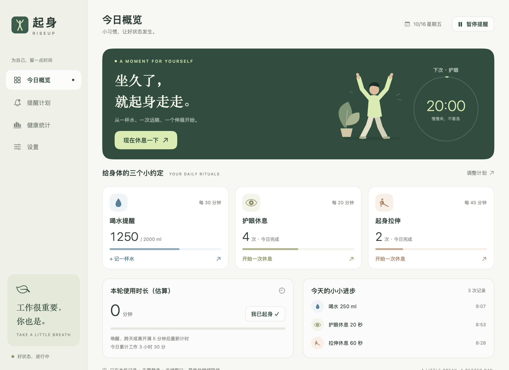
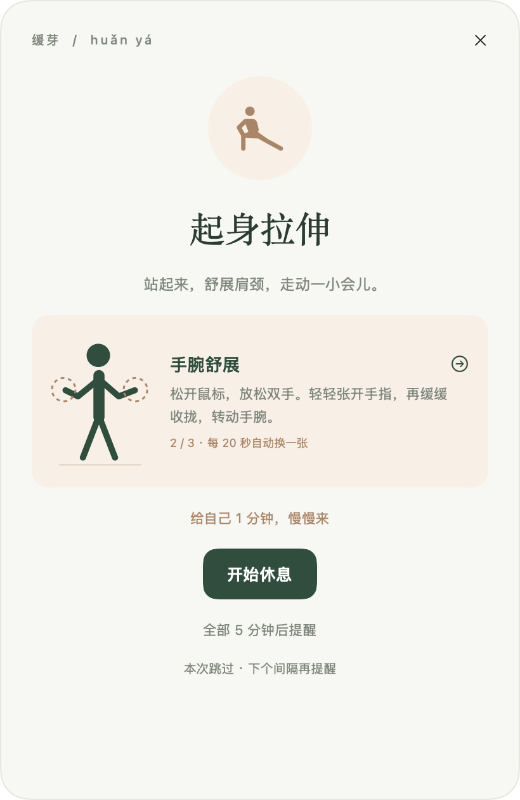

<h1 align="center">缓芽 · huǎn yá</h1>

<p align="center"><strong>工作很重要，你也是。</strong></p>
<p align="center">喝一杯水，望一会儿远处，起身舒展一下。<br>一个安静陪伴工作日的 macOS 休息提醒应用。</p>

<p align="center">
  <code>macOS 13+</code>&nbsp;&nbsp;
  <code>Intel / Apple Silicon</code>&nbsp;&nbsp;
  <code>本地记录</code>&nbsp;&nbsp;
  <code>SwiftUI</code>
</p>

<p align="center">
  <a href="#功能">功能</a>&nbsp; · &nbsp;
  <a href="#下载与安装">下载</a>&nbsp; · &nbsp;
  <a href="https://github.com/goseeen/huanya/issues">反馈建议</a>
</p>

<br>

<table>
  <tr>
    <td width="70%" align="center" valign="middle">
      <a href="docs/images/dashboard.png"></a>
      <p><sub>今日概览 · 把小习惯，看得见</sub></p>
    </td>
    <td width="30%" align="center" valign="middle">
      <a href="docs/images/stretch-guide.png"></a>
      <p><sub>休息引导 · 留一刻，给自己</sub></p>
    </td>
  </tr>
</table>

<p align="center"><sub>截图使用演示数据。点击图片可查看原图。</sub></p>

## 功能

**专注工作，也记得照顾自己。**

喝水、远眺、起身活动。缓芽用几个简单的提醒，帮你在忙碌中留一点时间给自己。

### 三种提醒，找到自己的节奏

**喝一杯水**  
忙起来容易忘记喝水，让缓芽帮你记着。默认每 30 分钟提醒，间隔、每杯水量和每日目标都能调整。随手记录，记错了也能撤销最近一杯。

**让目光离开屏幕**  
默认每 20 分钟，提醒你望一会儿远处。跟着可调整的倒计时休息片刻，再回到手头的事情。

**站起来，舒展一下**  
默认每 45 分钟，给身体一点活动的时间。肩膀放松、手腕舒展、站立走动，跟着动作图卡轻轻活动。图卡每 20 秒自动轮换，也可以手动切换；换图不会打断休息计时。

三个计划可以独立开启和调整。护眼与拉伸的休息时长既能选择常用值，也能自定义分钟和秒，支持 10 秒至 10 分钟，例如 3 分钟。倒计时结束并确认后，才记录一次完成的休息。

### 提醒有分寸，忙碌时留有余地

临近的提醒合在一起，休息前先给你一个安静的预告。正在专注，可以稍后处理；准备开会，可以开启忙碌模式。

工作时段、周末规则和指定应用暂停都能自行设置。电脑空闲或锁屏时，提醒也会跟着暂停。桌面浮窗或系统通知，选择你习惯的方式。

### 关掉窗口，也有缓芽陪着你

缓芽可以安静待在菜单栏，随时查看下一次提醒、记录一杯水，或开始一次休息。

喜欢更快捷的操作，还可以开启全局快捷键：`⌃⌥⌘W` 记录默认杯量，`⌃⌥⌘R` 开始拉伸休息。菜单栏倒计时、登录时自动启动与全局快捷键默认关闭，由你决定是否开启。按 `⌘Q` 可完全退出应用。

### 看见今天的小进步

今天喝了多少水、完成几次休息、工作了多长时间，都能一眼看到。

通过最近 7 天的趋势和一天中的工作分布，了解自己的节奏，也能回顾较长的连续工作时段。鼠标悬停在任意小时区域，即可查看具体时段与累计工作分钟数；零记录与未来时段分别提示。需要留存时，可以导出 CSV。

### 每次重新开始，都从这一刻计时

重启应用、睡眠后唤醒、跨天，或连续空闲 / 锁屏满 5 分钟后，本轮使用时长会重新计算。短暂离开时暂停并保留累计；点击“我已起身”或完成拉伸，也能开启新的一轮。

**计时只是一种使用时长估算，不识别实际坐姿。** 自动重置不会增加休息次数或改动历史记录，空闲和锁屏也不会被当作完成休息。

工作总时长按提醒的空闲暂停设置计算，默认连续 3 分钟无操作后暂停，可调整或关闭。暂停、睡眠、休息和指定提醒时段外不累计工作时间。唤醒或重启后重新安排提醒，不补发离开期间的提醒；退出后不计时、不提醒。

### 你的习惯，留在自己的电脑里

无需注册，没有账号，也不上传记录。设置和统计保存在本机，让缓芽成为一个简单、私人的日常工具。

节假日识别和日历读取尚未接入。目标可自行调整，应用提供一般提醒与记录，不提供医疗诊断。

> **1.0 · 首个正式版本**  
> 前往 [下载 1.0.0](https://github.com/goseeen/huanya/releases/tag/v1.0.0)，按电脑芯片选择 Intel 或 Apple 芯片安装包。

下一版改进：指定应用退出前台后继续剩余倒计时，预告中点击“现在休息”即可开始护眼或拉伸计时。目前已更新源码，尚未提供新版安装包，详见 [更新记录](CHANGELOG.md#未发布)。

## 本地数据、备份与隐私

无需账号，当前应用没有联网功能，不上传设置、统计或应用使用情况。数据保存在：

```text
~/Library/Application Support/RiseUp/state.json
```

旧版用户的设置与统计继续保留，无需迁移。数据目录名称保持兼容。

每日汇总持续保存；活动详情、提醒操作详情和连续工作时段各最多保留最近 1000 条 / 段。按本机日期划分每天，采用原子写入。若数据文件损坏，会提示并保留原文件。

空闲判断只读取系统汇总的无操作时长，不记录输入内容；前台暂停规则只读取应用标识，不读取窗口内容、不保存应用使用历史。全局快捷键只注册指定组合。系统通知和登录项按需启用。

备份时先退出应用，再复制上述文件。正常替换应用会保留设置与记录；清理工具若同时删除应用数据则不会保留。反馈问题不要直接上传个人 `state.json` 或未脱敏 CSV。


## 下载与安装

从 [1.0.0 发布页](https://github.com/goseeen/huanya/releases/tag/v1.0.0) 下载，两种架构选装一个即可：

| 电脑 | 安装包名称 |
| --- | --- |
| Intel Mac | `huanya-1.0.0-Intel-x86_64.dmg` |
| M 系列 Apple 芯片 Mac | `huanya-1.0.0-AppleSilicon-arm64.dmg` |

打开 DMG，将“缓芽.app”拖到 Applications，弹出映像后从“应用程序”启动。更新前先退出正在运行的应用；从旧版升级时，用新应用替换“起身 RiseUp.app”，不要同时保留并运行两个副本。个人设置与统计保存在上述数据目录中。

当前构建使用本地临时签名，尚未经过 Apple Developer ID 签名或公证。首次启动如被系统阻止，请确认来源，并按系统“隐私与安全性”的提示处理。随包的 `SHA256SUMS.txt` 用于检查下载完整性。

Apple 芯片版本为原生 arm64。当前开发机为 Intel，Apple 芯片实机验证仍待完成；交叉编译通过不代表已完成实机测试。


## 从源码运行

需要 macOS 13+、Apple Command Line Tools（或 Xcode）与 macOS SDK。纯 Swift，无第三方包依赖，无需 Node.js。

```sh
zsh scripts/test.sh
zsh scripts/build.sh
open "dist/缓芽.app"
```

## 构建、打包与演示模式

指定架构构建：

```sh
zsh scripts/build.sh x86_64
zsh scripts/build.sh arm64
```

产物分别在 `dist/x86_64/` 和 `dist/arm64/`。脚本进行本地临时签名并核对架构。

需要制作安装包时执行：

```sh
zsh scripts/package.sh          # 两种架构
zsh scripts/package.sh x86_64   # 仅 Intel
zsh scripts/package.sh arm64    # 仅 Apple 芯片
```

安装包输出至 `dist/releases/1.0.0/`。同名文件已存在时停止，避免覆盖历史包。脚本验证校验和，并只读挂载 DMG 检查架构、签名、版本与安装入口。可用 `zsh scripts/verify-packages.sh` 再次验证。

导出界面并运行原生交互检查：

```sh
"dist/缓芽.app/Contents/MacOS/RiseUp" --capture /tmp/huanya-preview
```

预览模式使用演示数据，不读写个人统计，不注册系统通知或登录项。重新生成应用图标可执行 `zsh scripts/icon.sh`。


## 参与与许可

欢迎通过 [Issues](https://github.com/goseeen/huanya/issues) 反馈问题或建议。见 [开发约定](CONTRIBUTING.md)、[更新记录](CHANGELOG.md) 与 [发布准备](docs/PUBLISHING.md)。

项目代码、文档与项目自制图形采用 [MIT License](LICENSE)，允许使用、修改与再分发，包括商业使用，需保留相应版权与许可声明。图标、人物、植物与动作图形在项目开发中由 AI 辅助制作，制作依据及系统资源边界见 [ASSETS.md](ASSETS.md) 和 [THIRD_PARTY_NOTICES.md](THIRD_PARTY_NOTICES.md)。名称与标识不因版权许可而授予商标权。

## 使用须知与免责声明

- **日常提醒，不替代医疗建议。** 饮水目标与拉伸图示是一般提示，请按自身情况调整；活动中如有不适应停止。
- **统计是估算。** 应用不检测实际坐姿或身体活动；系统状态与权限可能影响提醒，请勿依赖它处理紧急或关键事项。
- **记录保存在本机。** 更新、迁移或清理数据前建议备份；提交反馈前请移除个人信息。
- **按现状提供。** 担保与责任限制见 MIT 许可原文，并以适用法律允许的范围为限。

完整说明及素材权利反馈方式见 [使用说明与免责声明](DISCLAIMER.md)。

---

<p align="center"><sub>A LITTLE BREAK, A BETTER DAY.</sub></p>
